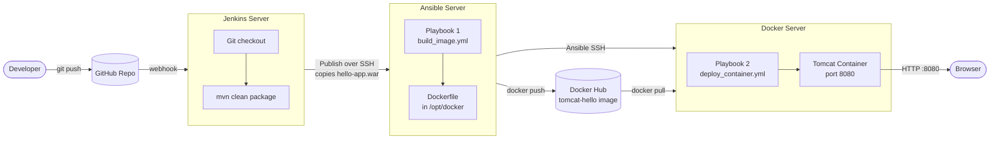

# Project 3: Automated Build and Deploy with Jenkins, Ansible, Docker Hub

Extends Projects 1 and 2. A GitHub push triggers Jenkins, which builds the `.war` file, hands it to an Ansible server, and runs Ansible playbooks that build a Docker image, push it to Docker Hub, and deploy it as a Tomcat container on the Docker server.

## Overview

| Item | Details |
|------|---------|
| Source control | GitHub |
| CI server | Jenkins (Project 1) |
| Configuration management | Ansible |
| Image registry | Docker Hub |
| Application server | Apache Tomcat (in a Docker container) |
| Deployment target | Docker server (Project 2) |
| Automation user | `ansadmin` (on Ansible and Docker servers) |

## Architecture



**Flow summary:**

| Step | From | To | Action |
|------|------|----|--------|
| 1 | Developer | GitHub | `git push` |
| 2 | GitHub | Jenkins | Webhook starts the job |
| 3 | Jenkins | Jenkins | Build `hello-app.war` with Maven |
| 4 | Jenkins | Ansible server | Copy `.war` to `/opt/docker` over SSH |
| 5 | Ansible server | Docker Hub | Build the image, then push it |
| 6 | Docker Hub | Docker server | Pull the image |
| 7 | Ansible server | Docker server | Run the deploy playbook over SSH |
| 8 | Docker server | Browser | Serve the app on port 8080 |

## Phase 1: Push Triggers the `.war` Build

**Goal:** A GitHub push builds the `.war` in Jenkins and places it on the Ansible server.

1. Created an Ansible server and a common user, `ansadmin`, on both the Ansible and Docker servers.
2. Set up passwordless SSH from Ansible to Docker:

   ```bash
   ssh-keygen
   ssh-copy-id ansadmin@<docker-server-private-IP>
   ssh ansadmin@<docker-server-private-IP>
   ```

   The Docker server is now a managed node of the Ansible server. Any task on it can run from the Ansible server.

3. Created the Ansible inventory at `/etc/ansible/hosts`:

   ```ini
   [docker]
   <docker-server-private-IP>

   [ansible]
   <ansible-server-private-IP>
   ```

4. Verified the connection:

   ```bash
   ansible all -m ping
   ```

5. Created the deployment folder on the Ansible server and gave ownership to `ansadmin`:

   ```bash
   sudo mkdir -p /opt/docker
   sudo chown -R ansadmin:ansadmin /opt/docker
   ```

6. In Jenkins, added the `ansadmin` details under **Manage Jenkins → System → Publish over SSH**, pointing at the Ansible server.
7. In the Jenkins job, set **Send build artifacts over SSH** to copy `target/*.war` to `//opt//docker` on the Ansible server.
8. Configured a GitHub webhook so each push starts the job.

## Phase 2: Build and Push the Docker Image

**Goal:** Ansible builds a Tomcat image that contains the `.war` and pushes it to Docker Hub.

1. Created a Dockerfile in `/opt/docker` on the Ansible server:

   ```dockerfile
   FROM tomcat:10.1-jdk21

   # Restore the default sample apps from webapps.dist
   RUN cp -R webapps.dist/. webapps/

   # Add the .war built by Jenkins
   COPY hello-app.war /usr/local/tomcat/webapps/
   ```

2. Added the Ansible server to the inventory (see Phase 1), so it can be managed by the same playbooks.
3. Wrote a playbook that builds the image and pushes it to Docker Hub:

   ```yaml
   - name: Build and push Docker image
     hosts: ansible
     tasks:
       - name: Build image
         community.docker.docker_image_build:
           name: <dockerhub-user>/tomcat-hello
           tag: latest
           path: /opt/docker

       - name: Push image to Docker Hub
         community.docker.docker_image_push:
           name: <dockerhub-user>/tomcat-hello
           tag: latest
   ```

4. Logged in to Docker Hub on the Ansible server:

   ```bash
   docker login
   ```

5. Added a Jenkins build step to run the playbook after the `.war` is copied:

   ```bash
   ansible-playbook /opt/docker/build_image.yml
   ```

## Phase 3: Pull and Run the Container on the Docker Server

**Goal:** Ansible deploys the image from Docker Hub to the Docker server.

1. Wrote a second playbook that pulls the image and runs the container:

   ```yaml
   - name: Deploy Tomcat container
     hosts: docker
     become: true
     tasks:
       - name: Pull latest image
         community.docker.docker_image:
           name: <dockerhub-user>/tomcat-hello
           tag: latest
           source: pull

       - name: Stop and remove old container
         community.docker.docker_container:
           name: tomcat-app
           state: absent

       - name: Run new container
         community.docker.docker_container:
           name: tomcat-app
           image: <dockerhub-user>/tomcat-hello:latest
           state: started
           published_ports:
             - "8080:8080"
   ```

2. Added the playbook to the Jenkins job so it runs after the image is pushed:

   ```bash
   ansible-playbook /opt/docker/deploy_container.yml
   ```

## Result

Each push runs the full pipeline:

1. GitHub webhook triggers Jenkins.
2. Jenkins builds `hello-app.war` and copies it to the Ansible server.
3. Playbook 1 builds the image and pushes it to Docker Hub.
4. Playbook 2 pulls the image on the Docker server and starts the container.
5. The app is live at `http://<docker-server-public-IP>:8080/hello-app/hello`.

## Key Learnings

- Managing remote servers with Ansible: inventory, SSH keys, and ad hoc commands.
- Writing playbooks to build, push, and deploy Docker images.
- Using Docker Hub as an image registry between build and deploy.
- Chaining Jenkins, Ansible, and Docker into one push-to-deploy pipeline.

## Next Steps

- Store Docker Hub credentials in Ansible Vault or Jenkins credentials.
- Tag images with the Jenkins build number instead of `latest`.
- Move the pipeline into a `Jenkinsfile`.
- Add a health check to the deploy playbook.
