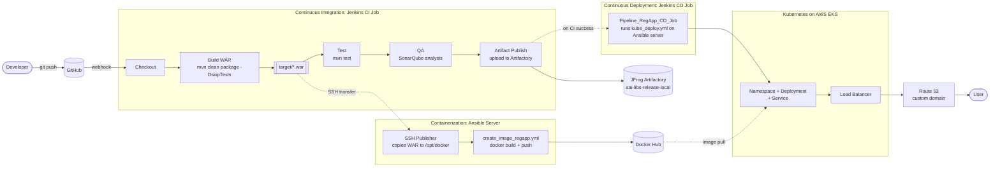

# MyIRCTC: End-to-End CI/CD Pipeline


A Java web application (**MyIRCTC**) that goes from a Git push to a live service on Kubernetes. Jenkins builds a WAR with Maven, checks code quality with SonarQube, stores the WAR in JFrog Artifactory, packages it into a Tomcat Docker image pushed to Docker Hub, and deploys it to AWS EKS through Ansible. Route 53 maps a custom domain to the service.

## Objectives

- Build a deployable `.war` with Maven on every push.
- Run SonarQube analysis on each build.
- Store the WAR in JFrog Artifactory with build information.
- Package the WAR into a Tomcat image and push it to Docker Hub.
- Deploy to Kubernetes through a separate CD job, which runs only after CI succeeds.
- Expose the application through a custom domain.

## Architecture



The full phase table and notes are in [`architecture/project-workflow.md`](architecture/project-workflow.md).

## Pipeline Walkthrough

### 1. Source control
A developer pushes to the `main` branch of GitHub. A webhook starts the CI job.

### 2. Continuous Integration (Jenkins)
[`jenkins/Jenkinsfile-CI`](jenkins/Jenkinsfile-CI) runs these stages on the Jenkins server:

1. **Checkout:** clone the code from GitHub.
2. **Build:** `mvn clean package -DskipTests` creates `target/*.war`.
3. **Test:** `mvn test` runs unit tests.
4. **QA:** SonarQube analysis. The pipeline does not wait for the quality gate result, so a failed gate does not stop the build.
5. **Artifact Publish:** upload the WAR to JFrog Artifactory with build info.
6. **Docker Image with Artifact:** the SSH Publisher copies the WAR to `/opt/docker` on the Ansible server, then runs `create_image_regapp.yml`. The playbook builds the Tomcat image from that WAR and pushes it to Docker Hub.
7. **post success:** starts the CD job.

### 3. Containerization (Ansible and Docker)
The Docker image is built from the WAR that Jenkins sent over SSH, not from the copy in Artifactory. Artifactory stores the WAR as the release record. The Dockerfile example is in [`docker/Dockerfile.example`](docker/Dockerfile.example).

### 4. Continuous Deployment (Jenkins CD)
[`jenkins/Jenkinsfile-CD`](jenkins/Jenkinsfile-CD) runs `kube_deploy.yml` on the Ansible server. The playbook applies the Kubernetes manifests in `kubernetes/`, which create the namespace, Deployment, and Service. Kubernetes then pulls the image from Docker Hub and starts the pods.

### 5. Exposure
A Load Balancer, created by the Kubernetes Service, receives traffic. Route 53 maps the custom domain to that Load Balancer. This DNS record is set manually in AWS and is not part of the pipeline.

## Implementation Status

| Component | Status | Location |
|---|---|---|
| Git and GitHub webhook | Implemented | Source repository |
| Jenkins CI pipeline | Implemented | [`jenkins/Jenkinsfile-CI`](jenkins/Jenkinsfile-CI) |
| Jenkins CD pipeline | Implemented | [`jenkins/Jenkinsfile-CD`](jenkins/Jenkinsfile-CD) |
| Maven WAR build | Implemented | Application `pom.xml` |
| SonarQube analysis | Implemented (no quality gate block) | `QA` stage |
| JFrog Artifactory upload | Implemented | `Artifact Publish` stage |
| Image build and push playbook | Template, to be verified | [`ansible/create_image_regapp.yml`](ansible/create_image_regapp.yml) |
| Deployment playbook | Template, to be verified | [`ansible/kube_deploy.yml`](ansible/kube_deploy.yml) |
| Dockerfile | Example | [`docker/Dockerfile.example`](docker/Dockerfile.example) |
| Kubernetes manifests | Template, to be verified | [`kubernetes/`](kubernetes/) |
| AWS EKS cluster | Assumed to exist; not created by this repo | — |
| Route 53 record | Set manually in AWS | — |
| Helm, Terraform, Prometheus, Grafana | Not implemented | Folders are placeholders |

## Repository Structure

```text
MyIRCTC-DevOps-CI-CD/
├── README.md
├── .gitignore
├── architecture/
│   └── project-workflow.md
├── jenkins/
│   ├── Jenkinsfile-CI
│   └── Jenkinsfile-CD
├── ansible/
│   ├── README.md
│   ├── hosts.example
│   ├── create_image_regapp.yml
│   └── kube_deploy.yml
├── docker/
│   └── Dockerfile.example
├── kubernetes/
│   ├── README.md
│   ├── namespace.yaml
│   ├── deployment.yaml
│   └── service.yaml
├── tools/
│   ├── README.md
│   └── (one file per tool)
├── monitoring/
│   └── README.md
├── terraform/
│   └── README.md
└── docs/
    ├── ci-pipeline.md
    ├── cd-pipeline.md
    ├── security.md
    └── troubleshooting.md
```

## Prerequisites

- Jenkins with the Maven Integration, Pipeline, SSH Publisher, Artifactory, and SonarQube Scanner plugins
- Maven and Java 21 on the Jenkins server
- SonarQube server
- JFrog Artifactory account and repository
- Ansible server with Docker, Ansible, the `community.docker` collection, and `kubectl`
- Docker Hub account
- A running Kubernetes cluster (AWS EKS)
- A domain in Route 53

## Setup

1. **Jenkins tools:** configure the Maven installation named `M2_HOME`.
2. **Jenkins system:** configure the SonarQube server (`saidemy-sonarqube-server`), the SSH server (`ansible-server`), and the Artifactory server.
3. **Jenkins credentials:** add `artifact-cred` (Artifactory user and token).
4. **Ansible server:** create `/opt/docker`. Copy `hosts.example` to `/opt/docker/hosts` with real values. Copy both playbooks there, and copy the `kubernetes/` manifests to `/opt/docker/kubernetes/`.
5. **Docker Hub:** run `docker login` as the SSH user on the Ansible server.
6. **Kubeconfig:** make sure the Ansible server's user can run `kubectl get nodes` against the cluster.
7. **Jenkins jobs:** create the CI job from `jenkins/Jenkinsfile-CI` and the CD job named `Pipeline_RegApp_CD_Job` from `jenkins/Jenkinsfile-CD`.
8. **Run CI:** push to `main` or start the build manually.
9. **Route 53:** create an A or CNAME record that points your domain to the Load Balancer hostname.

## Verification

- Build log shows `target/*.war`.
- SonarQube shows a new analysis.
- Artifactory shows the WAR with `buildid` and `commitid` properties.
- Docker Hub shows the new image.
- CD job succeeds, and `kubectl get pods -n <namespace>` shows running pods.
- The domain loads the application.

## Troubleshooting

See [`docs/troubleshooting.md`](docs/troubleshooting.md).

## Security

See [`docs/security.md`](docs/security.md). Credentials stay in Jenkins Credentials Manager and on the servers, never in this repository.

## Future Improvements

- Add `-DskipTests` only where needed, or run tests before packaging so the WAR is built only after tests pass.
- Add a quality gate step (`waitForQualityGate`) so a failed SonarQube check stops the pipeline.
- Tag images with the Git commit SHA or Jenkins build number instead of `latest`.
- Pull the WAR from Artifactory instead of copying it over SSH.
- Use Helm for the Kubernetes deployment.
- Provision EKS and Route 53 records with Terraform.
- Add Prometheus and Grafana monitoring.

## Key DevOps Concepts Demonstrated

- **CI vs CD:** separate jobs, with CD chained to a successful CI run.
- **Artifact management:** a versioned WAR stored in Artifactory with build info.
- **Containerization:** the Tomcat image packages a specific WAR build.
- **Configuration management:** Ansible drives the Docker and Kubernetes steps.
- **Quality checks:** SonarQube analysis on every build.
- **Secrets management:** credentials stay in Jenkins and on the servers.
- **Orchestration and DNS:** Kubernetes runs the pods, and Route 53 maps the domain.

## Author

**Prasann Parab**, DevOps Engineer
[LinkedIn](www.linkedin.com/in/prasannparab) · [Portfolio](https://prasannparab-portfolio.netlify.app/)
