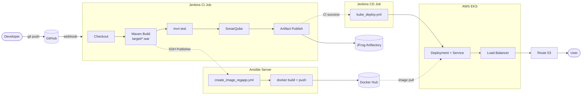

# Project Workflow

## Flow

1. Developer pushes code to GitHub.
2. GitHub webhook starts the Jenkins CI job.
3. Jenkins CI: checkout, Maven build (WAR), tests, SonarQube analysis, upload WAR to JFrog Artifactory.
4. Jenkins CI: SSH Publisher copies the WAR to `/opt/docker` on the Ansible server and runs `create_image_regapp.yml`.
5. The playbook builds a Tomcat Docker image from that WAR and pushes it to Docker Hub.
6. On CI success, Jenkins starts the CD job `Pipeline_RegApp_CD_Job`.
7. Jenkins CD: runs `kube_deploy.yml` on the Ansible server, which applies the Kubernetes manifests.
8. Kubernetes pulls the image from Docker Hub and runs the pods behind a Service and Load Balancer.
9. Route 53 maps the custom domain to the Load Balancer.

## Diagram

## Phase Summary

| Phase | Where it runs | Steps | Status |
|---|---|---|---|
| 1. Source control | Developer, GitHub | Push, webhook | Implemented |
| 2. CI | Jenkins server | Checkout, Maven WAR, tests, SonarQube, Artifactory upload | Implemented |
| 3. Containerization | Ansible server | WAR copy, Docker image build, Docker Hub push | Implemented (playbook is a template) |
| 4. CD | Ansible server, via Jenkins | `kube_deploy.yml` applies Kubernetes manifests | Implemented (playbook is a template) |
| 5. Runtime | AWS EKS | Pods pull image, Service, Load Balancer | Depends on manifests |
| 6. DNS | AWS Route 53 | Domain record to Load Balancer | Manual setup |

## Key Points

- **The WAR is the build output.** Maven creates it before tests, SonarQube, or Docker.
- **Artifactory stores the WAR.** The Docker build uses the WAR sent over SSH, not the Artifactory copy.
- **Docker Hub stores the image.** Kubernetes pulls it from there.
- **CI and CD are separate.** CD runs only after CI succeeds.
- **The quality gate does not block.** The pipeline does not call `waitForQualityGate`.
- **The EKS cluster and Route 53 record exist outside the pipeline.** Ansible only applies manifests to a cluster that already exists.
